# 온라인 소매 매출 시계열 분석 · 예측

[UCI Online Retail](https://archive.ics.uci.edu/dataset/352/online+retail) 거래 데이터를 날짜 단위 매출로 가공해 시계열 추세를 분석하고, 지수평활법(SES / Holt / Holt-Winters)과 SARIMA로 매출을 예측·비교하는 프로젝트입니다.

- 기간: 2010-12-01 ~ 2011-12-08 (373일)
- 대상 통화: GBP, 거래 수: 541,909건(원본) → 529,591건(전처리 후)
- 데이터 출처: UCI Machine Learning Repository, Daqing Chen (2015), **CC BY 4.0**. 자세한 출처는 [`data/raw/source.json`](data/raw/source.json) 참고.

## 빠른 시작

```bash
pip install -r requirements.txt
streamlit run app.py               # 클론 직후 바로 실행 가능 (가공 결과 data/processed/daily_sales.csv 포함)
```

분석을 처음부터 다시 재현하려면 **프로젝트 루트에서 `analysis/01`~`13`을 번호 순서대로 모두** 실행하세요.

```bash
for f in analysis/*.py; do python "$f"; done
```

`01_preprocess.py`가 `daily_sales.csv`를 새로 만들고, 이후 스크립트(`03`, `07`)가 이동평균·분해 열을 차례로 추가하므로 **`01`만 실행하고 앱을 켜면 오류가 납니다.** 각 스크립트는 같은 입력으로 다시 실행해도 같은 결과가 나오며, 원본(`data/raw/`)은 어떤 스크립트도 수정하지 않습니다. 그래프의 한글은 Windows 기본 폰트(맑은 고딕) 기준이라, 다른 OS에서 `analysis/` 스크립트로 그래프를 다시 만들면 한글이 깨질 수 있습니다(앱·커밋된 PNG는 영향 없음).

## 프로젝트 구조

```
온라인소매_매출흐름_실습/
├── app.py                  # Streamlit 인터랙티브 보고서
├── analysis/                # 01~13 순서대로 실행하는 분석 스크립트
├── data/
│   ├── raw/                 # 원본(Online Retail.xlsx), 수정하지 않음
│   └── processed/           # 가공 데이터(daily_sales.csv 등)
└── outputs/
    ├── figures/              # 아래에 포함된 모든 차트(PNG)
    └── tables/               # 아래에 포함된 모든 표(CSV)
```

---

## 1. 전처리: 거래 단위 → 날짜 단위

[`analysis/01_preprocess.py`](analysis/01_preprocess.py)에서 8단계 제외 규칙을 순서대로 적용합니다. 기준은 [`report/전처리_기준.md`](report/전처리_기준.md)에 정리되어 있고, 실행 결과는 그 기준과 숫자 단위까지 정확히 일치합니다.

| 단계 | 규칙 | 제외 건수 | 제외 금액 | 남은 행 수 | 남은 금액 |
|---|---|---:|---:|---:|---:|
| 2-1 | 완전 중복 행 | 5,268 | +21,740.98 | 536,641 | 9,726,006.95 |
| 2-2 | 회계 조정 코드 | 90 | −247,691.63 | 536,551 | 9,973,698.58 |
| 2-3 | 수기 정정·할인·샘플 | 706 | −77,767.51 | 535,845 | 10,051,466.09 |
| 2-4 | 배송비 | 2,110 | +279,462.12 | 533,735 | 9,772,003.97 |
| 2-5 | 상품권 판매 | 34 | +685.81 | 533,701 | 9,771,318.16 |
| 2-6 | 단가 0 이하 | 2,493 | 0.00 | 531,208 | 9,771,318.16 |
| 2-7 | 취소 아닌 음수 수량 | 0 | 0.00 | 531,208 | 9,771,318.16 |
| 2-8 | 불완전한 마지막 날(12/9 이후) | 1,617 | +29,530.26 | 529,591 | 9,741,787.90 |

(표: [`outputs/tables/preprocessing_exclusion_log.csv`](outputs/tables/preprocessing_exclusion_log.csv))

제외 후 거래는 날짜별로 집계해 `net_sales`(순매출), `gross_sales`, `cancel_amount`, 송장·고객·수량 등을 계산하고, 2010-12-01~2011-12-08 전체 날짜로 빈 날짜를 채웁니다(휴무일은 0). 결과는 [`data/processed/daily_sales.csv`](data/processed/daily_sales.csv)(373행), 거래 단위 정제본은 [`data/processed/transactions_clean.csv`](data/processed/transactions_clean.csv)로 저장됩니다.

---

## 2. 일별 매출 추이

[`analysis/02_daily_sales_trend.py`](analysis/02_daily_sales_trend.py) — 휴무일, 이상치(요일별 log(net_sales)의 MAD 기준 `|z|>3.5`)를 함께 표시.

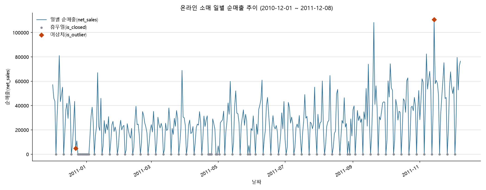

### 이동평균 (7일 / 14일 후행)

[`analysis/03_moving_average.py`](analysis/03_moving_average.py) — 창이 길수록 요일별 변동을 더 눌러 완만한 추세만 남습니다.

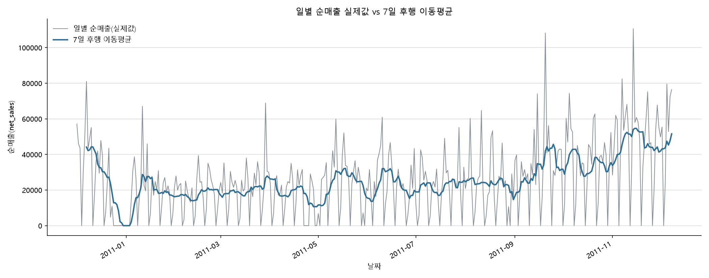
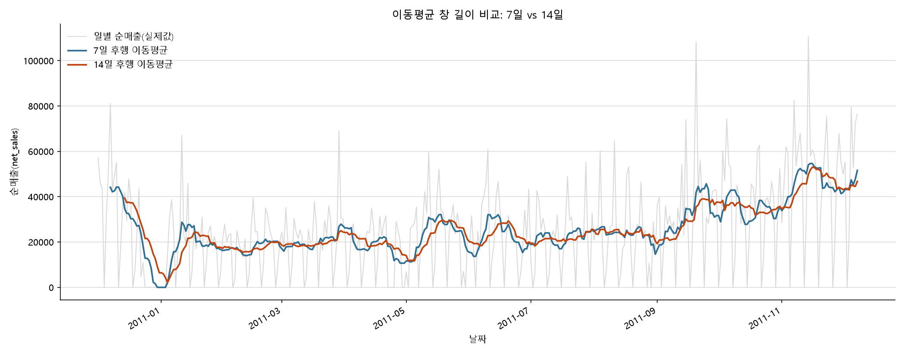

---

## 3. 월별 분석

[`analysis/04_monthly_breakdown.py`](analysis/04_monthly_breakdown.py)

| 월 | 날짜수 | 매출 합계 | 하루평균 |
|---|---:|---:|---:|
| 2010-12 | 31 | 758,090.50 | 24,454.53 |
| 2011-01 | 31 | 578,855.19 | 18,672.75 |
| 2011-02 | 28 | 499,464.35 | 17,838.01 |
| 2011-03 | 31 | 679,329.21 | 21,913.85 |
| 2011-04 | 30 | 482,061.93 | 16,068.73 |
| 2011-05 | 31 | 731,004.77 | 23,580.80 |
| 2011-06 | 30 | 723,845.14 | 24,128.17 |
| 2011-07 | 31 | 676,812.08 | 21,832.65 |
| 2011-08 | 31 | 701,289.93 | 22,622.26 |
| 2011-09 | 30 | 1,011,339.74 | 33,711.32 |
| 2011-10 | 31 | 1,061,701.22 | 34,248.43 |
| 2011-11 | 30 | 1,427,124.54 | 47,570.82 |
| 2011-12 | 8 | 410,869.30 | 51,358.66 |

(표: [`outputs/tables/monthly_net_sales_summary.csv`](outputs/tables/monthly_net_sales_summary.csv))

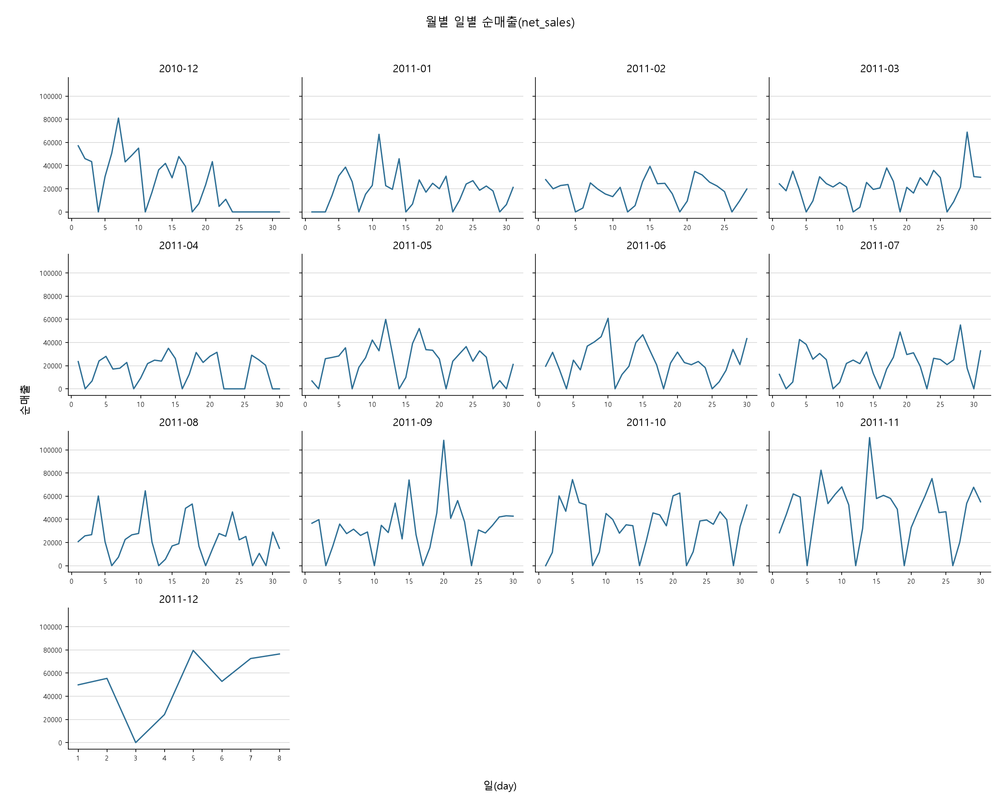
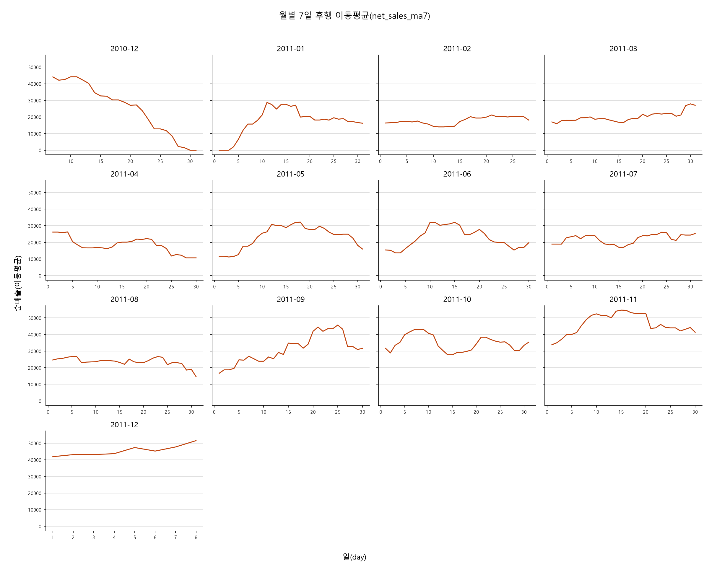

---

## 4. 요일 분석

[`analysis/05_weekday_avg.py`](analysis/05_weekday_avg.py) — 토요일은 전체 기간(53일) 전부 휴무.

| 요일 | 영업일 | 휴무일 | 전체평균 | 영업일평균 | 중앙값 | 표준편차 | 비중 |
|---|---:|---:|---:|---:|---:|---:|---:|
| 월 | 47 | 6 | 30,607.7 | 34,515.0 | 27,770.5 | 18,788.2 | 16.7% |
| 화 | 52 | 1 | 37,133.5 | 37,847.6 | 32,981.5 | 18,153.3 | 20.2% |
| 수 | 53 | 1 | 32,200.8 | 32,808.3 | 27,834.3 | 15,795.1 | 17.8% |
| 목 | 53 | 1 | 38,527.5 | 39,254.5 | 35,309.1 | 16,064.8 | 21.4% |
| 금 | 49 | 4 | 29,082.6 | 31,456.7 | 26,371.4 | 13,933.1 | 15.8% |
| 토 | 0 | 53 | 0.0 | — | — | — | 0.0% |
| 일 | 50 | 3 | 14,920.8 | 15,816.0 | 12,194.1 | 9,964.4 | 8.1% |

(표: [`outputs/tables/weekday_net_sales_summary.csv`](outputs/tables/weekday_net_sales_summary.csv))

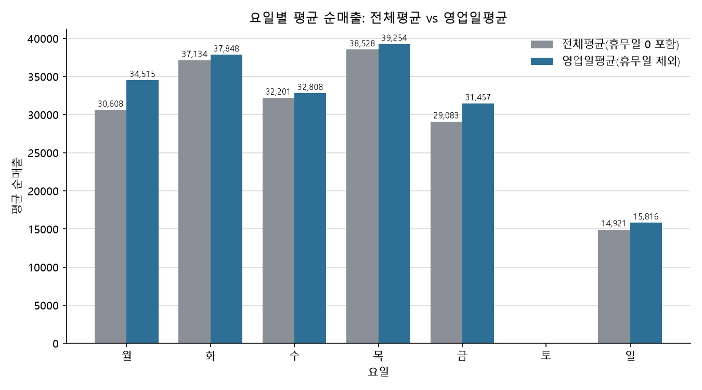
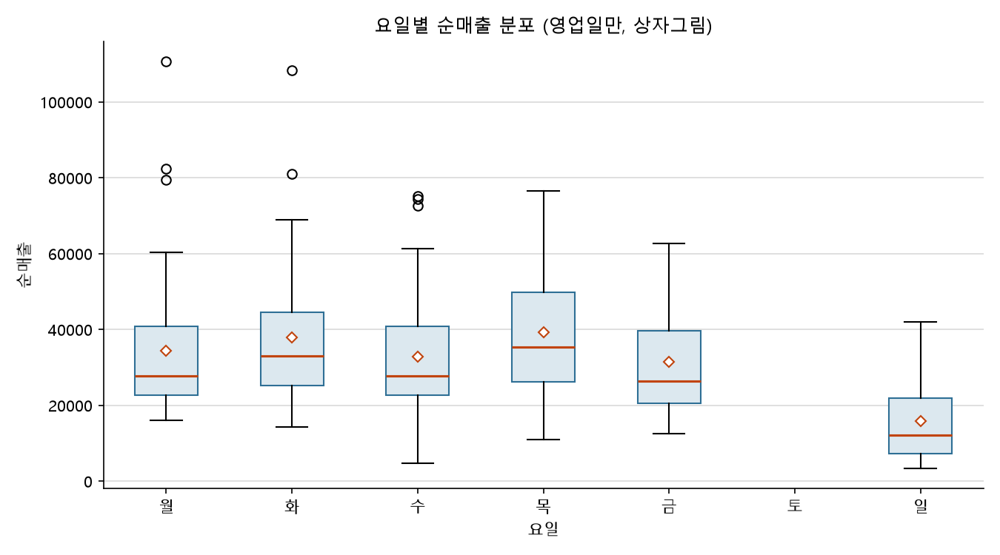

---

## 5. 국가 분석

[`analysis/06_country_analysis.py`](analysis/06_country_analysis.py) — 전체 38개국. 영국이 매출의 84.75%를 차지해 영국 제외 그래프를 함께 제공.

| 국가 | 순매출 | 비중 | 송장수 | 고객수 | 건당평균 |
|---|---:|---:|---:|---:|---:|
| United Kingdom | 8,256,487.60 | 84.75% | 17,865 | 3,916 | 477.52 |
| Netherlands | 283,479.54 | 2.91% | 93 | 9 | 3,052.57 |
| EIRE | 259,380.02 | 2.66% | 282 | 3 | 960.46 |
| Germany | 199,073.94 | 2.04% | 439 | 93 | 464.32 |
| France | 181,827.15 | 1.87% | 381 | 87 | 483.58 |
| Australia | 136,922.50 | 1.41% | 56 | 9 | 2,466.14 |
| Switzerland | 52,483.05 | 0.54% | 50 | 21 | 1,061.31 |
| Spain | 51,746.65 | 0.53% | 88 | 30 | 633.03 |
| Belgium | 36,469.32 | 0.37% | 97 | 25 | 378.70 |
| Japan | 35,419.79 | 0.36% | 19 | 8 | 1,969.28 |

(전체 38개국: [`outputs/tables/country_sales_summary.csv`](outputs/tables/country_sales_summary.csv))

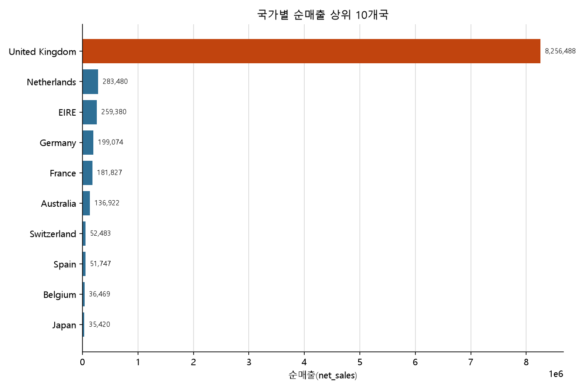
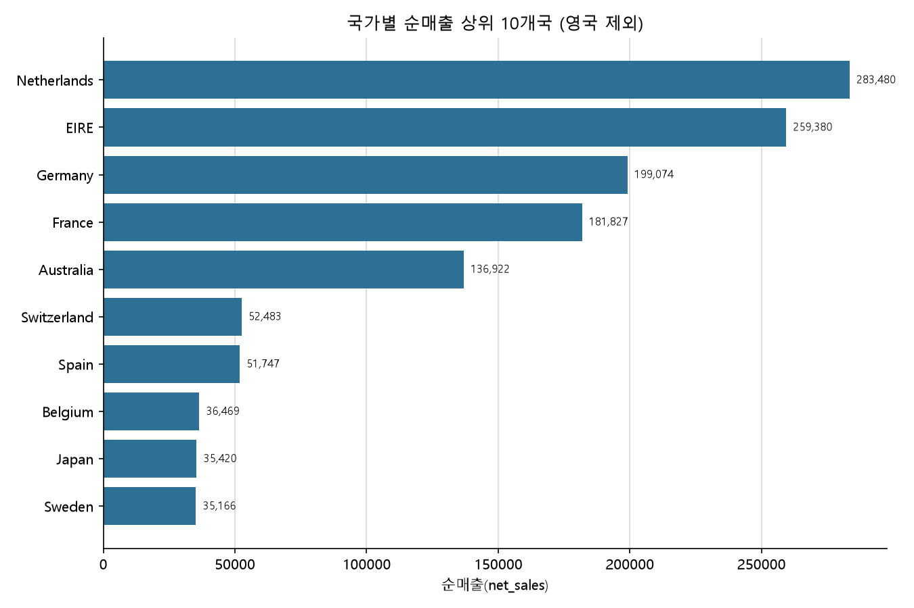

---

## 6. 시계열 분해

[`analysis/07_decomposition_monthly_grid.py`](analysis/07_decomposition_monthly_grid.py), [`analysis/08_decomposition_per_month.py`](analysis/08_decomposition_per_month.py)

```
net_sales = trend(7일 중심이동평균) + weekday_effect(요일효과, 합 0) + resid(잔차)
```

**요일효과** (합 0): 월 +4,641.6 · 화 +11,325.2 · 수 +5,438.0 · 목 +12,163.5 · 금 +3,237.5 · 토 −25,842.5 · 일 −10,963.3

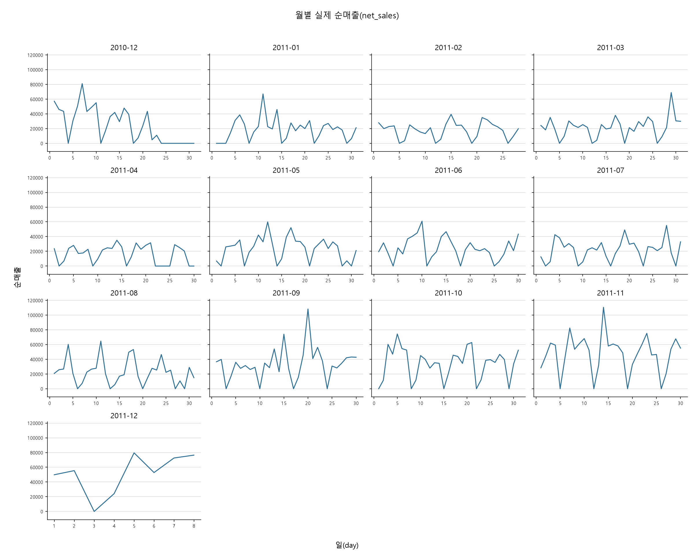
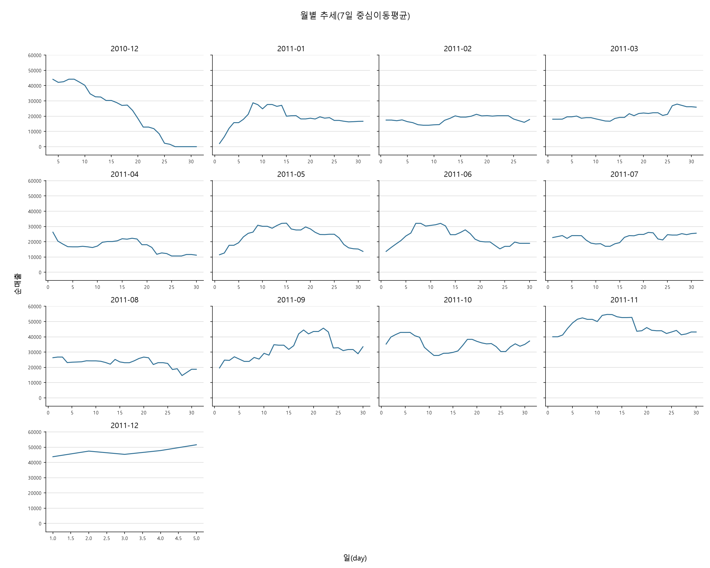
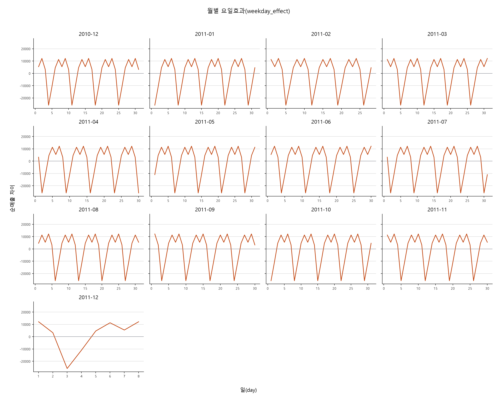
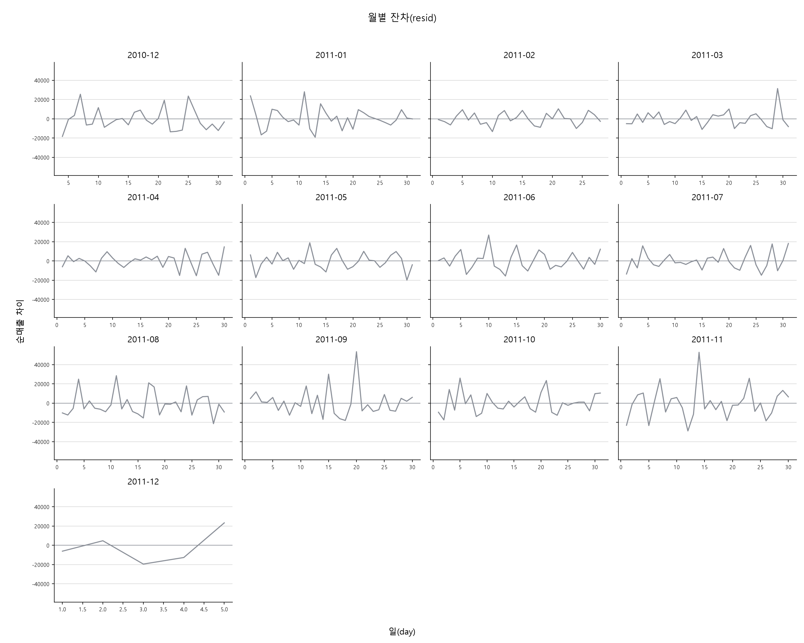

월별로 한 장씩 보고 싶다면 `outputs/figures/decomp_2010-12.png` ~ `decomp_2011-12.png` (13개 파일, 달마다 실제값/추세/요일효과/잔차 4단 그래프)을 참고하세요.

---

## 7. ARIMA 사전 점검: 자기상관(ACF)

[`analysis/12_arima_acf.py`](analysis/12_arima_acf.py) — 학습기간(2011-01-01~2011-10-31) 기준.

| 시차(lag) | 자기상관계수 |
|---|---:|
| 7일 | 0.602 |
| 14일 | 0.551 |
| 21일 | 0.494 |

7·14·21일 주기에서 뚜렷하게 솟아 있어 **주 단위(7일) 계절성**이 확인되고, 이는 SARIMA의 계절 차수(m=7) 선택 근거가 됩니다.

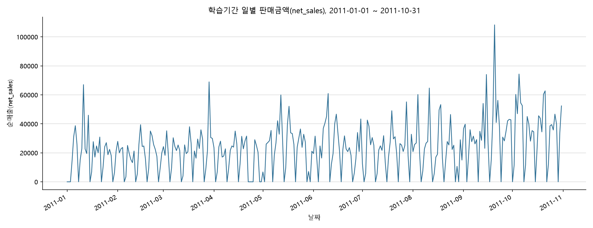
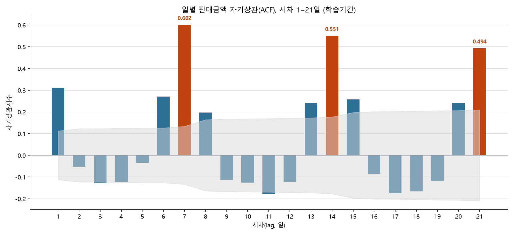

---

## 8. 매출 예측: SES vs Holt vs Holt-Winters vs SARIMA

학습 2011-01-01~2011-10-31(304일), 검증 2011-11-01~2011-11-30(30일). 평활계수·초기값은 모두 학습 자료로 자동 추정(SSE 최소화), SARIMA 차수는 AIC 격자탐색(36개 조합)으로 자동 결정.

| 모델 | 설정 | MAE | RMSE | MAPE |
|---|---|---:|---:|---:|
| SES | α=0.0350 | 24,583.9 | 28,897.2 | 38.70% |
| Holt | α=0.0480, β=0.0000(감쇠없음) | 22,803.5 | 27,212.0 | 35.21% |
| Holt-Winters | α=0.0773, β=0.0000, γ=0.0805, 주기 7일 | 14,339.8 | 19,525.5 | 26.05% |
| **SARIMA(1,1,2)(0,1,1)₇** | AIC=6194.60 (36개 조합 중 최적) | **12,521.8** | **17,932.5** | **23.29%** |

(표: [`outputs/tables/all_models_forecast_metrics.csv`](outputs/tables/all_models_forecast_metrics.csv), SARIMA 차수 탐색 전체: [`outputs/tables/sarima_order_search.csv`](outputs/tables/sarima_order_search.csv))

추세(Holt)만 더해도 SES보다 나아지고, 요일 계절성(Holt-Winters)을 반영하면 크게 개선되며, SARIMA가 네 모델 중 오차가 가장 작습니다.

[`analysis/13_sarima_forecast.py`](analysis/13_sarima_forecast.py)

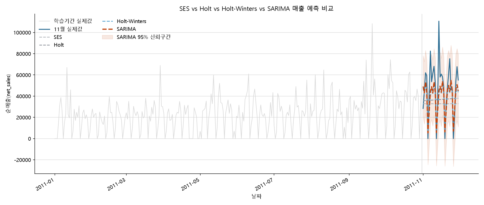
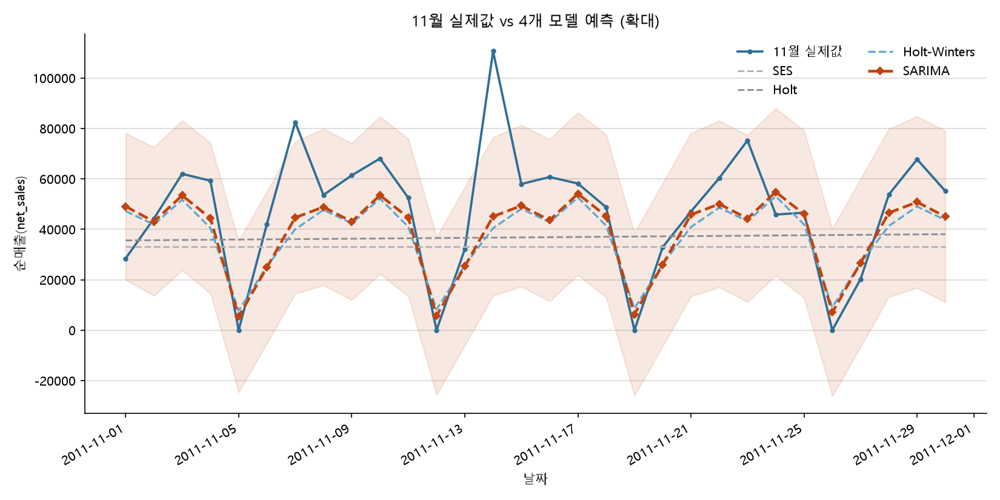

---

## 9. Streamlit 인터랙티브 보고서

```bash
streamlit run app.py
```

사이드바에서 기간·휴무일 포함 여부를 필터링할 수 있고, 8개 탭(전처리 요약 · 일별 추이 · 월별 분석 · 요일 분석 · 국가 분석 · 시계열 분해 · 예측 모형 비교 · 이상치)에서 위 분석을 모두 인터랙티브 차트(Plotly)로 다시 확인할 수 있습니다. 예측 모형 비교 탭은 11월뿐 아니라 실제 데이터가 있는 12월 1~8일까지 확장해 보여주고, SES/Holt/Holt-Winters/SARIMA 4개 모델을 함께 비교합니다.

### 화면 캡처

| 전처리 요약 (KPI + 제외 로그) | 국가 분석 |
|---|---|
| 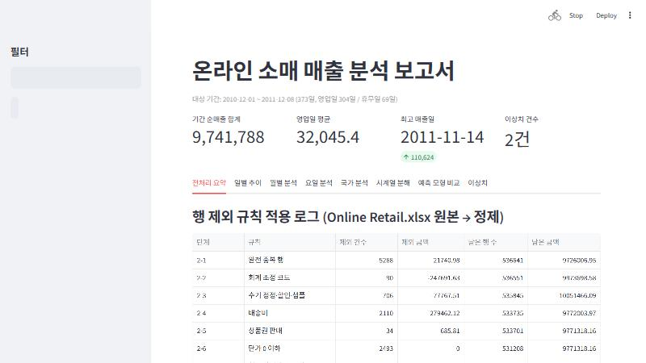 | 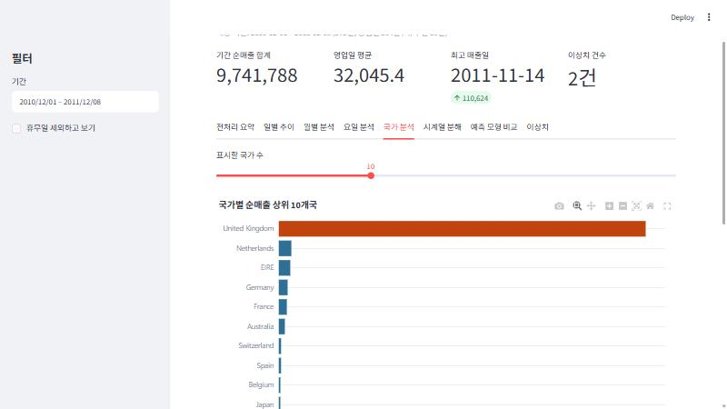 |

| 시계열 분해 (월 선택) | 예측 모형 비교 |
|---|---|
| 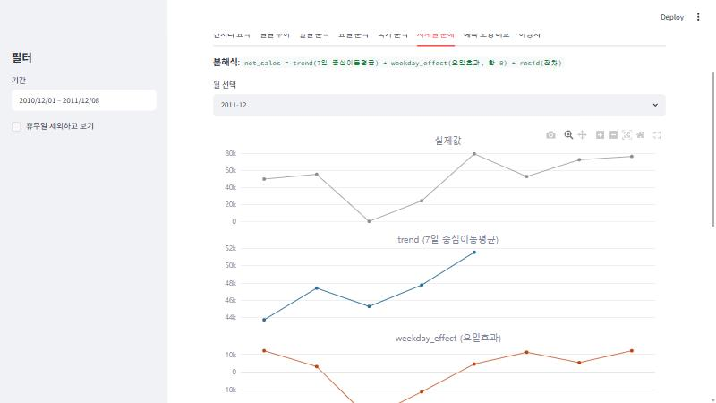 | 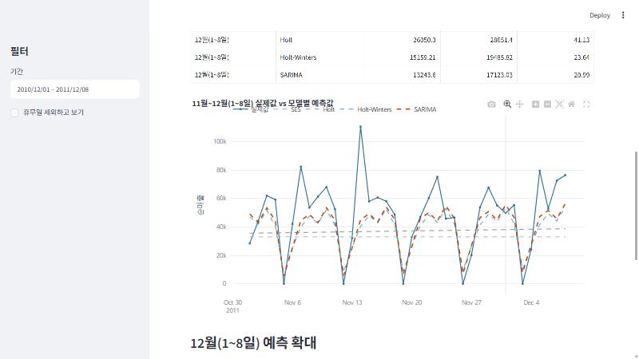 |

---

## 데이터 출처 및 라이선스

데이터: Chen, Daqing. (2015). *Online Retail* [Dataset]. UCI Machine Learning Repository. [https://doi.org/10.24432/C5BW33](https://doi.org/10.24432/C5BW33), License: [CC BY 4.0](https://creativecommons.org/licenses/by/4.0/). 원본 워크북은 수정 없이 그대로 사용했습니다(상세: [`data/raw/source.json`](data/raw/source.json)).
